 

 

I build web interfaces and Python applications, and I'm growing into backend engineering with Django and FastAPI. I learn by shipping small, complete projects — each one below exists because I wanted to understand something properly.

### Profile

| | |
|---|---|
| **Role** | Python & Frontend Developer |
| **Languages** | Python · JavaScript · SQL · HTML · CSS |
| **Frontend** | React · Bootstrap · responsive design |
| **Backend** | Django · Django REST Framework · FastAPI · SQLAlchemy *(in progress)* |
| **Data** | MySQL · SQLite · joins, schema design, CRUD · Pandas & NumPy basics |
| **Tooling** | Git · GitHub · Visual Studio Code |

### Selected work

### Technology

### Trajectory

| Shipped | In progress | Planned |
|---|---|---|
| GitHub developer profile | React component design | End-to-end applications |
| Personal portfolio website | Django & FastAPI depth | Machine learning fundamentals |
| Python practice projects | REST API design & testing | Docker & cloud deployment |
| SQL database projects | Pandas & NumPy | Open-source contributions |

### GitHub at a glance

 

Open to feedback, collaboration and conversations about code. &nbsp;·&nbsp; <a href="https://neetunawani11.github.io/">neetunawani11.github.io</a>

